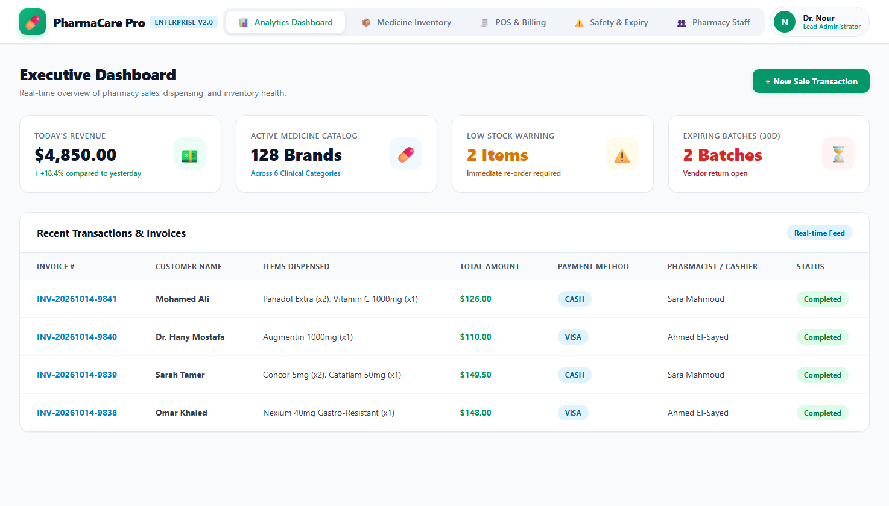
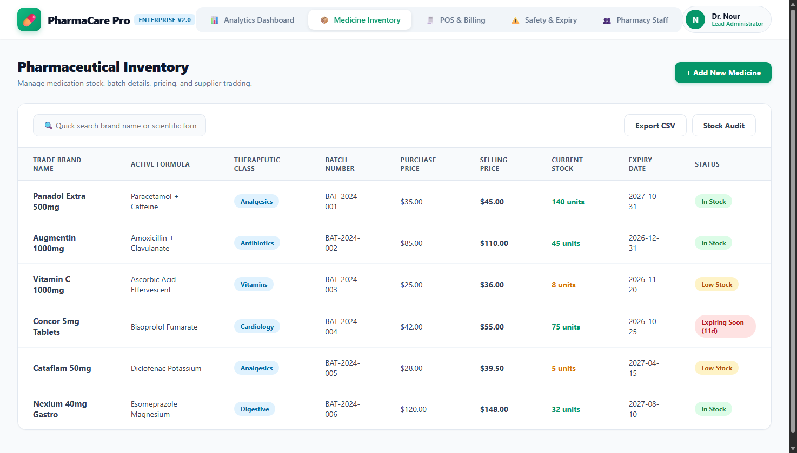
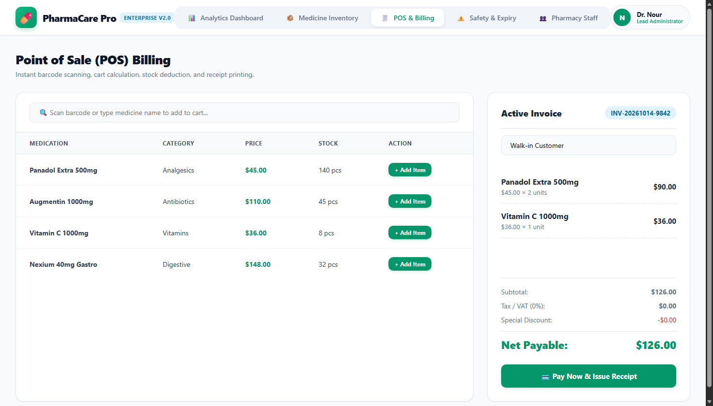
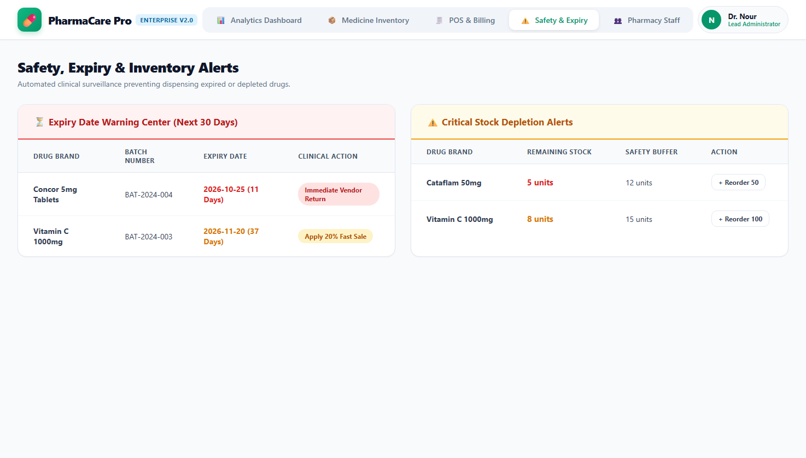
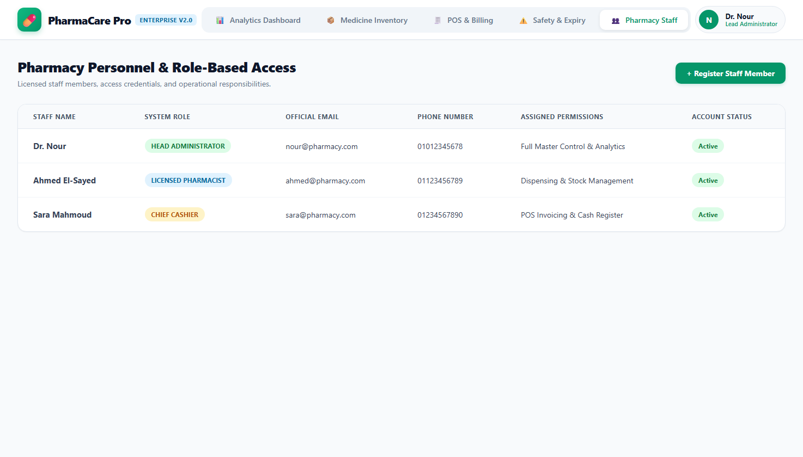

# 🏥 PharmaCare Pro • Pharmacy Management System (Full-Stack)

[](https://www.oracle.com/java/)
[](https://spring.io/projects/spring-boot)
[](https://spring.io/projects/spring-data-jpa)
[](https://www.mysql.com/)
[](https://swagger.io/)
[](https://junit.org/junit5/)

An enterprise-grade, production-ready **Pharmacy Management System** featuring a complete **Spring Boot 3 Backend** and a clean, responsive **Medical Web Client (Embedded UI)**. The system provides real-time drug tracking, early-warning expiry radars, inventory replenishment alerts, and an atomic Point-of-Sale (POS) invoicing engine.

---

## 📸 Screenshots & System Walkthrough

### 1. 📊 Executive Analytics Dashboard
Provides live metrics on daily revenue, registered drug catalogs, critical stock alerts, and real-time transaction streaming.


---

### 2. 📦 Pharmaceutical Inventory Management
Comprehensive data table displaying trade names, generic chemical formulas, batch numbers, purchase/selling pricing, and live stock statuses.


---

### 3. 🧾 Express Point of Sale (POS) & Billing
Quick barcode scanning, automated cart calculation, expired medication safety locks, stock deduction, and instant invoice issuance.


---

### 4. ⚠️ Clinical Safety, Expiry & Low Stock Alerts
Surveillance radar categorizing medicines expiring within 30 days and alerting when quantities reach or fall below buffer thresholds.


---

### 5. 👥 Pharmacy Staff & Role Control
Manage staff credentials, assigned operational roles (`ADMIN`, `PHARMACIST`, `CASHIER`), and system permissions.


---

## 🏗️ Clean 3-Tier Layered Architecture

```mermaid
flowchart TD
    Client["Client Browser / POS Terminal"] --> StaticUI["Embedded Web Client (Spring Static Resources)"]
    StaticUI --> ControllerLayer["REST API Layer (@RestController)"]
    ControllerLayer --> ServiceLayer["Service & Transactional Layer (@Transactional)"]
    ServiceLayer --> RepoLayer["Data Access Layer (Spring Data JPA)"]
    RepoLayer --> Database[("Database: H2 (Dev) / MySQL (Prod)")]

    subgraph DTOs & Safety Validation
        Req["Request DTOs (@Valid)"]
        Resp["Response DTOs"]
    end

    ControllerLayer -.-> DTOs & Safety Validation
```

---

## ✨ Core Business Features

1. **🔒 Safety Enforcement:** Strict transactional verification (`@Transactional`) that completely blocks dispensing expired pharmaceuticals.
2. **📦 Inventory Tracking:** Batch control, purchase/selling margins, barcode indexing, and automatic stock deduction.
3. **⚠️ Early-Warning Alerts:** Dynamic queries identifying drugs expiring soon and items nearing stockout.
4. **👥 Multi-Role Authorization:** Dedicated operational workflows for Head Administrators, Licensed Pharmacists, and Cashiers.
5. **📑 Interactive OpenAPI Documentation:** Built-in Swagger UI for real-time endpoint testing.

---

## 📡 API Endpoints Reference

### 💊 Medicines (`/api/medicines`)
| Method | Endpoint | Description |
| :--- | :--- | :--- |
| `GET` | `/api/medicines` | Retrieve all medicines |
| `GET` | `/api/medicines/{id}` | Get medicine by ID |
| `GET` | `/api/medicines/search?query=...` | Search by trade name or generic formula |
| `GET` | `/api/medicines/alerts/low-stock` | Retrieve all low-stock medicines |
| `GET` | `/api/medicines/alerts/expired` | Retrieve all expired medications |
| `GET` | `/api/medicines/alerts/expiring-soon?days=30` | Retrieve drugs expiring within N days |
| `POST` | `/api/medicines` | Register a new medicine record |
| `PUT` | `/api/medicines/{id}` | Update existing medicine details |
| `DELETE` | `/api/medicines/{id}` | Remove a medicine record |

### 🧾 Sales & POS (`/api/sales`)
| Method | Endpoint | Description |
| :--- | :--- | :--- |
| `GET` | `/api/sales` | Retrieve all historical sales transactions |
| `GET` | `/api/sales/{id}` | Get detailed invoice by Sale ID |
| `GET` | `/api/sales/invoice/{invoiceNo}` | Lookup receipt by invoice number |
| `POST` | `/api/sales` | Process a sale, deduct inventory, and issue an invoice |

---

## 🚀 Running the Project

### Zero-Setup Mode (Integrated UI + In-Memory Database)
Run the application with Maven:
```bash
mvn spring-boot:run
```
Then navigate directly in your browser:
* **Pharmacy UI Suite:** [http://localhost:8080/](http://localhost:8080/)
* **Interactive Swagger UI:** [http://localhost:8080/swagger-ui.html](http://localhost:8080/swagger-ui.html)
* **H2 Database Console:** [http://localhost:8080/h2-console](http://localhost:8080/h2-console)

### Running with MySQL
Create a database named `pharmacy_db` and activate the `mysql` profile:
```bash
mvn spring-boot:run -Dspring-boot.run.profiles=mysql
```

---

## 🧪 Automated Testing
Run the comprehensive JUnit 5 and Mockito test suite:
```bash
mvn test
```

---

## 👨‍💻 Author
**Dr. Nour** - Software Engineer & AI Specialist.
