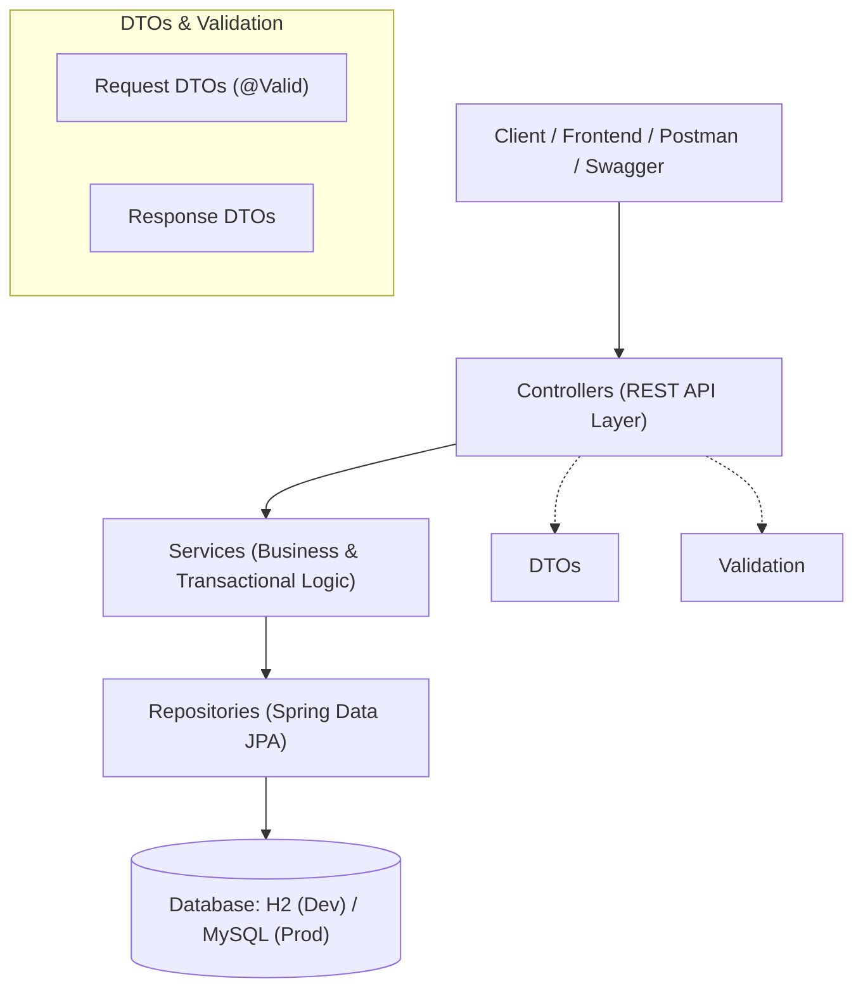

# 🏥 Pharmacy Management System (REST API)

[](https://www.oracle.com/java/)
[](https://spring.io/projects/spring-boot)
[](https://spring.io/projects/spring-data-jpa)
[](https://www.mysql.com/)
[](https://swagger.io/)
[](https://junit.org/junit5/)

An enterprise-grade, production-ready **Pharmacy Management System Backend** built with **Java** and **Spring Boot 3**. It features robust drug inventory control, automated stock alerts, expiry date tracking, and a transactional Point-of-Sale (POS) invoicing engine.

---

## 🏗️ Architectural Overview (3-Tier Layered Architecture)

The system strictly adheres to Clean Architecture and Separation of Concerns:



---

## ✨ Key Features

1. **📦 Smart Inventory & Drug Tracking:**
   - Manage trade names, scientific generic names, batch numbers, barcodes, categories, and pricing.
   - Real-time stock status calculations (`isLowStock()`, `isExpired()`).

2. **⚠️ Automated Early-Warning Alerts:**
   - **Low Stock Alert:** Identifies medications whose quantity has reached or fallen below safety thresholds.
   - **Expiry Tracking:** Filter expired medications and anticipate medications expiring within a configurable window (e.g., 30 days).

3. **🧾 Point-of-Sale (POS) & Invoicing Engine:**
   - Generates unique invoice numbers (e.g., `INV-20261014-A1B2`).
   - Automatically checks available stock and prevents transaction completion if inventory is insufficient.
   - **Safety Enforcement:** Strict business rule blocking sales of expired pharmaceuticals.
   - Atomically updates inventory upon successful checkout (`@Transactional`).

4. **👥 Role-Based Staff Management:**
   - Supports explicit operational roles: `ADMIN`, `PHARMACIST`, `CASHIER`, `MANAGER`.
   - Toggle account active status without losing transaction history.

5. **🛡️ Global Exception Handling & Uniform API Responses:**
   - Centralized `@RestControllerAdvice` translates domain exceptions into standard, structured JSON error payloads with precise validation field feedback.

6. **📄 Interactive API Documentation:**
   - Integrated OpenAPI (Swagger UI) allows real-time endpoint testing directly from the browser.

---

## 📡 API Endpoints Reference

### 💊 Medicines (`/api/medicines`)
| Method | Endpoint | Description |
| :--- | :--- | :--- |
| `GET` | `/api/medicines` | Retrieve all medicines |
| `GET` | `/api/medicines/{id}` | Get medicine by ID |
| `GET` | `/api/medicines/search?query=...` | Search by trade name or generic scientific name |
| `GET` | `/api/medicines/alerts/low-stock` | Retrieve all low-stock medicines |
| `GET` | `/api/medicines/alerts/expired` | Retrieve all expired medications |
| `GET` | `/api/medicines/alerts/expiring-soon?days=30` | Retrieve drugs expiring within N days |
| `POST` | `/api/medicines` | Create a new medicine record |
| `PUT` | `/api/medicines/{id}` | Update existing medicine details |
| `DELETE` | `/api/medicines/{id}` | Remove a medicine record |

### 🧾 Sales & POS (`/api/sales`)
| Method | Endpoint | Description |
| :--- | :--- | :--- |
| `GET` | `/api/sales` | Retrieve all historical sales transactions |
| `GET` | `/api/sales/{id}` | Get detailed invoice by Sale ID |
| `GET` | `/api/sales/invoice/{invoiceNo}` | Lookup receipt by invoice number |
| `POST` | `/api/sales` | Process a sale, deduct inventory, and issue an invoice |

### 🏷️ Categories (`/api/categories`)
| Method | Endpoint | Description |
| :--- | :--- | :--- |
| `GET` | `/api/categories` | List all medicine categories |
| `POST` | `/api/categories` | Create a new category |
| `PUT` | `/api/categories/{id}` | Update a category |
| `DELETE` | `/api/categories/{id}` | Delete a category |

### 👤 Users & Staff (`/api/users`)
| Method | Endpoint | Description |
| :--- | :--- | :--- |
| `GET` | `/api/users` | List all staff members |
| `GET` | `/api/users/role/{role}` | Filter staff by role (`ADMIN`, `PHARMACIST`, etc.) |
| `POST` | `/api/users` | Register a new user |
| `PATCH` | `/api/users/{id}/toggle-active` | Activate or deactivate account |

---

## 🚀 Getting Started

### Prerequisites
- **JDK 17 or 21** installed.
- (Optional) **MySQL 8.0** if running in production mode.

### 1. Zero-Setup Run (In-Memory Database)
By default, the application runs with an in-memory **H2 Database** seeded with sample categories, medicines, and staff:
```bash
./mvnw spring-boot:run
```
*(On Windows Command Prompt or PowerShell: `mvn spring-boot:run`)*

### 2. Running with MySQL
Create a database named `pharmacy_db` in your MySQL server:
```sql
CREATE DATABASE pharmacy_db;
```
Then run with the `mysql` profile activated:
```bash
./mvnw spring-boot:run -Dspring-boot.run.profiles=mysql
```

---

## 📖 Swagger Documentation & Testing

Once the application is running:
- **Swagger UI:** [http://localhost:8080/swagger-ui.html](http://localhost:8080/swagger-ui.html)
- **OpenAPI JSON Docs:** [http://localhost:8080/v3/api-docs](http://localhost:8080/v3/api-docs)
- **H2 Console:** [http://localhost:8080/h2-console](http://localhost:8080/h2-console) (JDBC URL: `jdbc:h2:mem:pharmacydb`, Username: `sa`, Password: empty)

---

## 🧪 Automated Testing

Run the automated JUnit 5 and Mockito test suite:
```bash
./mvnw test
```

---

## 👨‍💻 Author
**Nour** - Software Engineer & AI Specialist.
